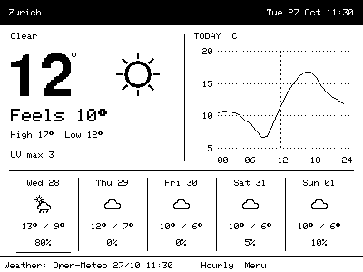
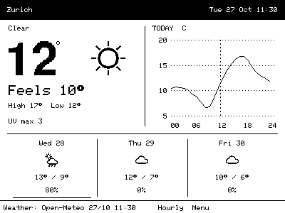

# CrowPanelWeather

Weather forecast firmware for the **Elecrow CrowPanel ESP32-S3 4.2-inch, 400×300 monochrome e-paper HMI**. It uses Open-Meteo without an API key for personal, noncommercial use.

Includes Classic three / Classic five views, physical-button menus, microSD setup, saved preferences, offline forecast caching, hourly updates and manual refresh. USB is the default profile; Battery adds scheduled deep sleep and Menu-button wake.




These frames come from the actual renderer with sample forecast data. Both panel builds compile and native parser/renderer tests are included. **A physical board has not been flashed or tested in this project yet.** Panel appearance, SD compatibility, power consumption and wake behavior need the first hardware check.

## What you need

- Elecrow CrowPanel 4.2-inch e-paper board with ESP32-S3-WROOM-1-N8R8.
- USB-C **data** cable and a computer.
- FAT32 microSD card and card reader for initial setup; back up a card before formatting it if needed.
- 2.4 GHz Wi-Fi with internet access. WPA/WPA2 personal or an open network; captive portals and enterprise authentication are not implemented.
- [Visual Studio Code](https://code.visualstudio.com/) with [PlatformIO IDE](https://docs.platformio.org/en/latest/integration/ide/vscode.html), or Python with PlatformIO Core 6.1.18.

No OpenWeatherMap or Weather Underground account is needed.

## Installation

### 1. Download the project

Extract the repository ZIP, or clone it:

```sh
git clone https://github.com/cc454/CrowPanelWeather.git
cd CrowPanelWeather
```

Open the folder containing `platformio.ini` in PlatformIO. Keep the entire project, including `assets/` and `include/`. On Windows use a short path, such as `C:\Projects\CrowPanelWeather`, to avoid ESP32 compiler path-length failures. Use PowerShell rather than Git Bash for building/flashing.

### 2. Prepare the microSD card

Copy `config/secrets.example`, `config/location.example` and `config/settings.example` to the **root of the card**, removing `.example` from each name. They must be named exactly **`secrets`**, **`location`** and **`settings`**, without extensions. Enable file extensions in your file manager to avoid accidentally creating `secrets.txt`.

Edit with a plain-text editor and save as UTF-8 JSON. Keep quotation marks and commas.

`secrets` — Wi-Fi credentials:

```json
{"wifi_ssid":"YOUR_WIFI_NAME","wifi_password":"YOUR_WIFI_PASSWORD"}
```

`location` — decimal coordinates; these example coordinates are Zurich:

```json
{"latitude":47.3769,"longitude":8.5417,"label":"Zurich","timezone":"auto"}
```

Latitude accepts −90…90; longitude −180…180. Use decimal points, not commas. `auto` resolves the location's timezone; an explicit supported IANA name such as `Europe/Zurich` also works. Short ASCII labels display most predictably in the compact font.

`settings` — optional; defaults are:

```json
{"forecast_days":5,"power_profile":"usb","show_sun_times":false,"show_wind":false}
```

Forecast days accepts **3 or 5**; power profile accepts **usb or battery**. Optional sunrise/sunset and wind appear in day details. Automatic updates are fixed at 60 minutes.

Eject the card safely and insert it into the unpowered board. Hot swapping is not required. Credentials are plaintext on the card and in saved board setup; private files must not be committed.

### 3. Select the panel revision

| Board | Build environment |
| --- | --- |
| Revised panel with a green circular sticker on the rear | `crowpanel_green` — default |
| Original panel without the sticker | `crowpanel_legacy` |

The fixed GPIOs are identical, but the controller commands differ. If serial logs show the app running while the screen stays blank/garbled, check the revision and try the other environment. Do not change GPIOs to compensate for a wrong driver.

### 4. Build and upload

In PlatformIO project tasks, select the correct environment, then **Build**, followed by **Upload**. The first build downloads pinned compiler/library versions.

Equivalent command-line steps:

```sh
pio run -e crowpanel_green
pio device list
pio run -e crowpanel_green -t upload --upload-port COM4
pio device monitor --port COM4 --baud 115200
```

Replace `COM4` with your board's port, such as `/dev/ttyACM0` on Linux. Use `crowpanel_legacy` in both build/upload commands for the original panel. Close the serial monitor before uploading again.

If the board is not detected, try a known data cable and another USB socket. To enter download mode manually: hold **Boot**, press/release **Reset**, then release **Boot**. Upload again. Press Reset after uploading if needed. USB ports may change between download mode and the app.

For command-line installation: `python -m pip install platformio==6.1.18`. Use `python -m platformio` instead of `pio` if it is not on PATH. Linux users may need their distribution's serial-port permissions.

Do **not** use Upload filesystem for configuration: files come from the microSD card, and internal cache storage initializes itself. A normal PlatformIO upload writes the supplied partition layout and replaces the existing application.

### 5. First boot

The app validates the card files, connects to Wi-Fi, synchronizes time, fetches forecasts and draws the selected view. Allow about a minute for the first connection/refresh. The network must allow DNS, HTTPS and NTP. Full e-paper refreshes briefly flash the panel.

It saves the validated setup internally and writes alternate forecast cache slots internally and to the card. Errors show setup guidance or retain the last good forecast. **Menu → Status / help** and the 115200-baud serial monitor provide details; the app does not print passwords.

## Controls and configuration

| Control | Action |
| --- | --- |
| Menu | Open menu; wake from battery sleep |
| Switch up/down | Move focus or select an outlook day |
| Switch press | Open day details or confirm a setting |
| Exit | Return home, or cancel an unconfirmed view/power change |
| Reset | Restart; preserve saved settings |
| Boot | Hardware download-mode control |

Select **Menu → Forecast view → Classic three / Classic five → press**. The confirmed choice survives restart and redraws cached data without fetching again or resetting the hourly schedule. Exit cancels. Menus return home after 30 seconds of inactivity.

**Refresh** fetches between hourly updates. Repeated requests coalesce; manual fetches have a 60-second cooldown. Failures back off for 1, 5, then 15 minutes. Rate-limit/service-unavailable responses respect numeric or HTTP-date `Retry-After`, up to seven days.

Edit card files on your computer and reinsert before restarting. Credentials/location are read at boot; saved menu choices for view, power and optional fields take precedence over card settings. **Reload configuration** explicitly reapplies all card values. Invalid files retain the last-known-good configuration.

After successful setup, the board can operate without the card using its internal configuration/cache. A location change never uses the old location's forecast. `cache-a`, `cache-b` and `cache-tmp` may appear on the card; leave them to the app. Alternate validated slots protect the previous cache against an interrupted write. A damaged internal cache filesystem may be reformatted automatically; NVS configuration is separate.

## Weather meanings

- Current and Feels are model/provider values, not readings from an onboard sensor.
- High is today's calendar-day maximum. **Low** is the overnight minimum from 18:00–06:00; before 06:00 it refers to the night that began yesterday.
- UV max is today's forecast maximum.
- The graph covers the location's current day. Dotted lines every 5°C round outward to enclose the range; missing hours stay gaps. Local timezone rules support 23-/25-hour days. Very wide ranges retain every gridline but omit colliding interior labels.
- Outlook days exclude today. They show daily high/low and maximum hourly precipitation probability, not rainfall volume.
- The footer shows the last successful fetch. Failures do not advance it; data older than two hours is stale. Missing values show `--`.

Weather data: [Open-Meteo](https://open-meteo.com/), attribution under CC BY 4.0. The free hosted endpoint is used here for noncommercial use. Alternate providers are not implemented.

## Battery profile

Start with USB to check Wi-Fi and the panel. Select **Menu → Power profile → Battery** to sleep after 30 seconds of inactivity. The board wakes for an update or when Menu is pressed. Button wake opens the menu using cached data without forcing a fetch. Select USB to return to continuous interaction.

The app does not automatically detect the power source or show an uncalibrated battery percentage. Wiring, charging compatibility, USB/battery handover, wake behavior and runtime still need verification on your actual board. Elecrow specifies nominal 3.7 V lithium and SH1.0 two-pin; confirm connector polarity and charging ratings. No minimum Ah capacity is established by the software.

## Troubleshooting

| Symptom | Check |
| --- | --- |
| Blank/garbled screen with app logs | Green/legacy build, board revision and supply; display busy times out after 20 seconds |
| No weather data | Exact filenames without `.txt`, valid JSON, coordinates and credentials |
| Wi-Fi fails | 2.4 GHz personal/open network; no captive portal; spelling and signal |
| Time sync fails | Router permits NTP; HTTPS certificate checking requires a valid clock |
| HTTPS/certificate failure | DNS/internet and clock; maintainers can refresh `include/weather_ca.h` using `tools/update-resources.py`, then rebuild |
| Card unreadable | FAT32 filesystem; card inserted before boot; root-level files |
| Card settings ignored | Menu choices persist; Reload configuration reapplies card values |
| Buttons feel slow | Full refresh takes several seconds; network fetches run separately |
| Old data remains | Check last-success time/status; e-paper retains an image without power |

## Development and validation

```sh
pio run -e crowpanel_green -e crowpanel_legacy
python tools/test-native.py
```

Native checks need a C++17 compiler (`g++` by default, or `--compiler "clang++"` / `--compiler "zig c++"`) and PlatformIO-installed libraries. Pillow optionally converts rendered PBM frames to PNG. Linux also tests DST transitions; Windows skips those cases because its C runtime does not fully implement POSIX transition expressions. ESP32/newlib uses POSIX timezone support.

The committed forecast fixture keeps tests offline. Intentionally update it with `python tools/fetch-fixture.py`. `tools/update-resources.py` refreshes the verified API trust anchor and IANA/POSIX table; ordinary builds need neither script. GitHub Actions compiles both revisions, runs native checks and uploads firmware parts/rendered frames.

Physical first-flash, orientation/contrast, controls, SD compatibility and measured sleep/wake current remain unverified. OTA, web provisioning, indoor sensors and alternate weather providers are outside this version.

[Requirements](requirements.md) · [User stories](user-stories.md) · [Hardware specifications](specs) · [Assets](assets/README.md) · [Third-party notices](THIRD_PARTY.md)
