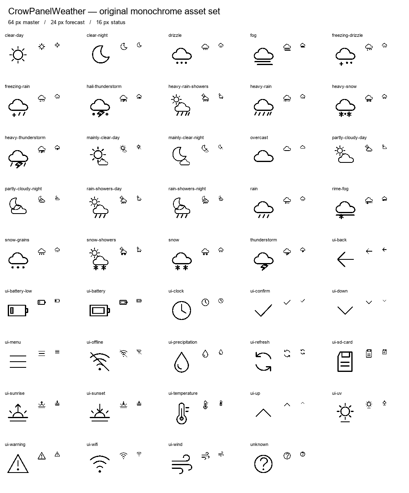
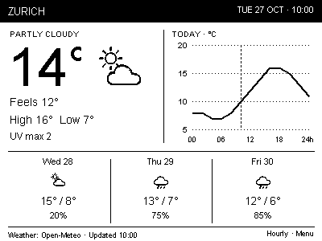
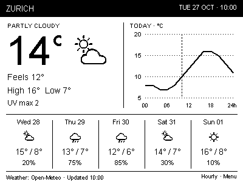

# CrowPanelWeather graphical assets

Original monochrome line artwork for the selected 400×300 Classic three / Classic five layouts. These are real assets, not firmware or a live weather application.



## Contents

- `svg/`: 44 editable originals: 25 weather icons and 19 interface/metric icons. Transparent background, black strokes, no external fonts or resources.
- `include/icons_16.h`, `icons_24.h`, `icons_32.h`, `icons_48.h`, `icons_64.h`: fixed-size 1-bit versions of every icon.
- `include/icons_current.h`: 25 weather icons normalized to **48 pixels of visible ink height**, preserving aspect ratio. The padded canvas is at least 96×48; use its exported width/height constants. Match the temperature numeral ink height to 48 px. Do not compare font point size to icon canvas size.
- `manifest.json`: dimensions, visible ink bounds and byte counts for every bitmap.
- `weather-codes.json`: complete mapping for Open-Meteo's documented WMO codes, including day/night alternatives and an unknown fallback. Several intensities intentionally share artwork; keep exact descriptions in details. Daily outlook uses day artwork.
- `classic-3.png`, `classic-5.png`: actual-resolution integration previews using these assets and illustrative Zurich data. They are reference images, not whole-screen firmware bitmaps.
- `include/display_graphics.h`: black header and dynamic dotted graph-grid drawing helpers.




## Firmware bitmap format

One bit per pixel; **1 = foreground ink**, 0 = untouched background. Rows are padded to whole bytes, most-significant bit first. This matches Adafruit-GFX-style `drawBitmap`, **not** `drawXBitmap` (which expects LSB-first bytes). Arrays have internal linkage and Arduino `PROGMEM` placement; include only the sizes needed. No decoder or SVG renderer is needed on the ESP32.

```cpp
#include "assets/include/icons_current.h"
#include "assets/include/icons_24.h"
// display must offer an Adafruit-GFX-compatible drawBitmap method.
display.drawBitmap(101, 58,
  cpw_assets::partly_cloudy_day_current,
  cpw_assets::partly_cloudy_day_current_width,
  cpw_assets::partly_cloudy_day_current_height,
  GxEPD_BLACK);
```

Use 24 px icons in five-day forecasts, 24 or 32 px in three-day forecasts after verifying row spacing, and 16 px for status. Include the current header plus chosen forecast/status sizes rather than all sizes by default. SVG strokes are rasterized with size-adjusted widths and thresholded to pure black/white pixels. Clear the destination region before changing icons so old ink does not remain.

The black header and graph grid are drawn procedurally: location/date text and 5°C bounds vary at runtime. Do not use the static preview as a screen background. Graph grid bounds use floor(low/5)×5 and ceil(high/5)×5; a flat exact multiple expands by 5°C each way. The grid uses today's whole-day temperature range, independently of the home-screen overnight Low.

## Regenerate

1. Install Node.js, Playwright and a Chromium browser; set `CPW_BROWSER_PATH` if needed. Set `CPW_NODE_MODULES` when Playwright is outside Node's normal module lookup.
2. `node tools/generate-assets.cjs`
3. Install Python and Pillow; run `python tools/pack-assets.py` (optional `--current-height 48`).

The scripts write intermediate square rasters to `assets/raster/` and normalized rasters to `assets/current/`; these regenerable files are ignored. The committed headers contain those pixels. Previews, manifests and headers are rebuilt. Arial is used from Windows for preview labels only and is not distributed; set `CPW_PREVIEW_FONT` on other systems.

Automated checks verify all packed pixels by decoding them, ensure square icons have unclipped artwork, and confirm each current icon has the requested visible height. The 1-bit sheet and both layouts were visually reviewed. Physical-panel legibility and refresh behavior still need hardware verification.

Original artwork: CC0-1.0; see `LICENSE`. Generator/helper code: MIT; see `../tools/LICENSE`. No Lucide or other third-party icon artwork is included. Preview sample data is illustrative. Weather-code meanings follow [Open-Meteo's documentation](https://open-meteo.com/en/docs); actual weather-data attribution remains required in the app.
